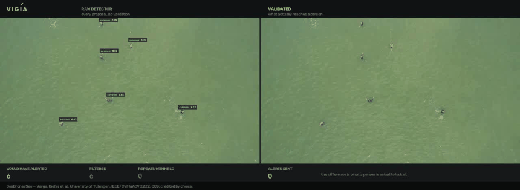
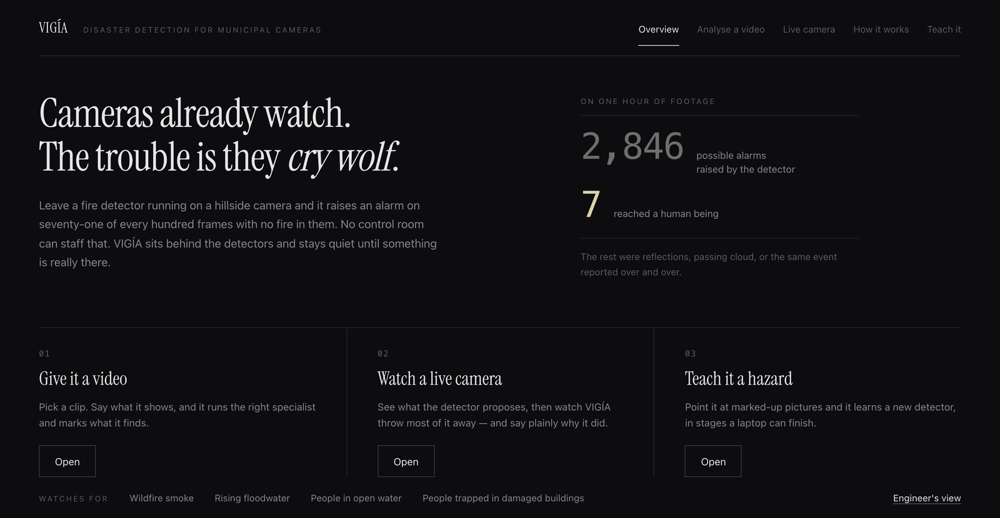
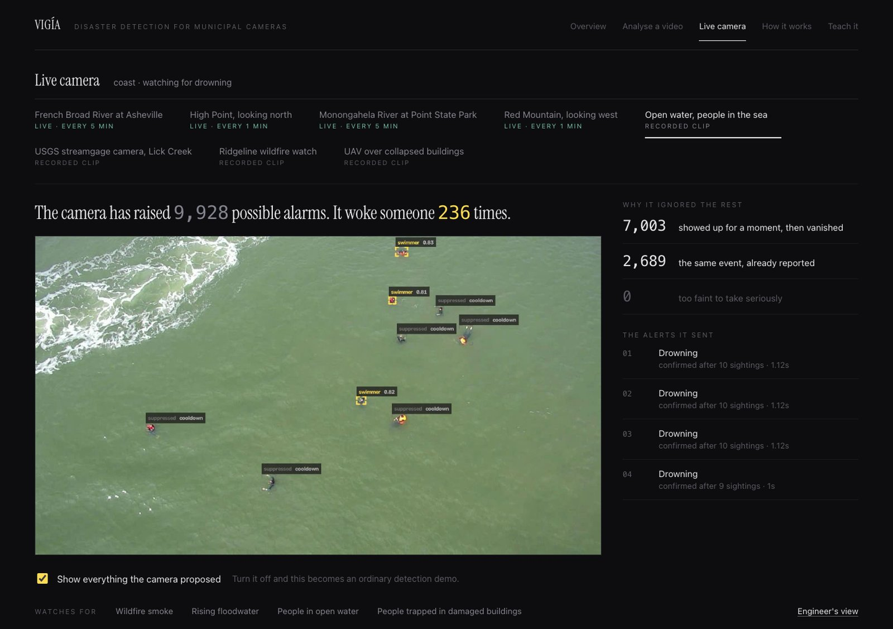
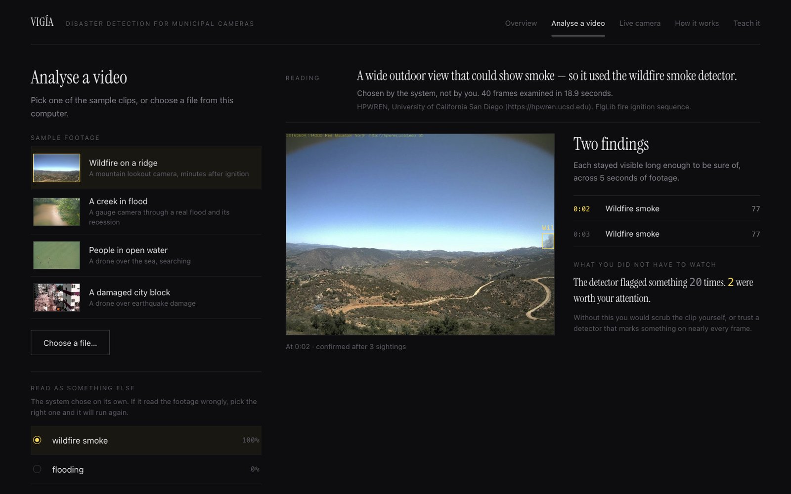
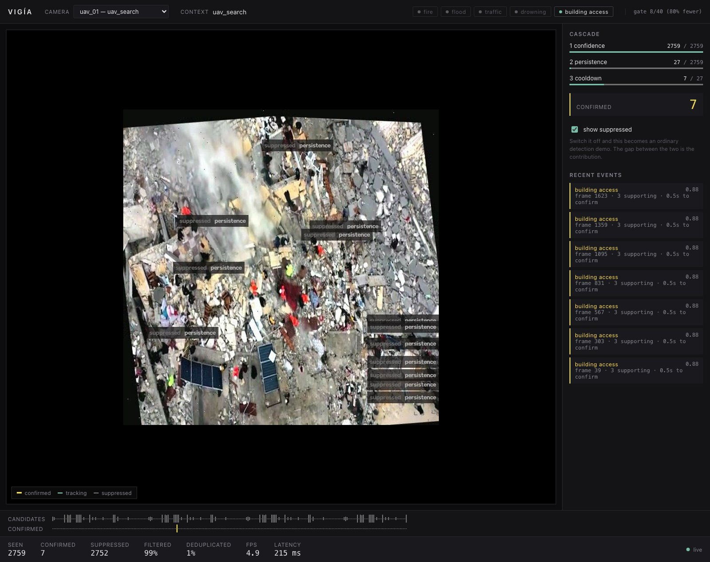
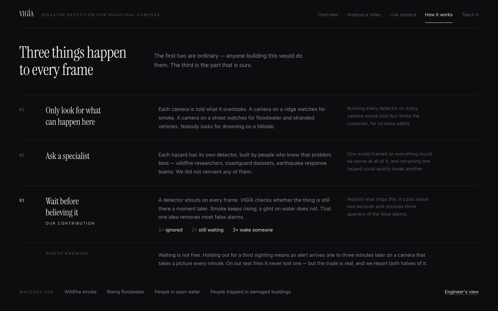
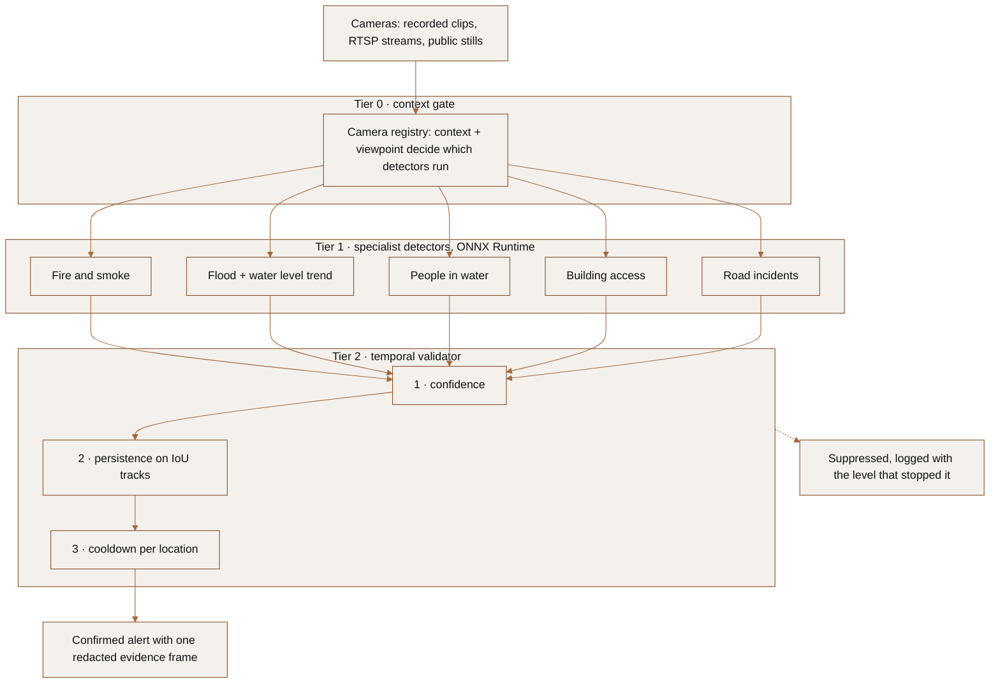
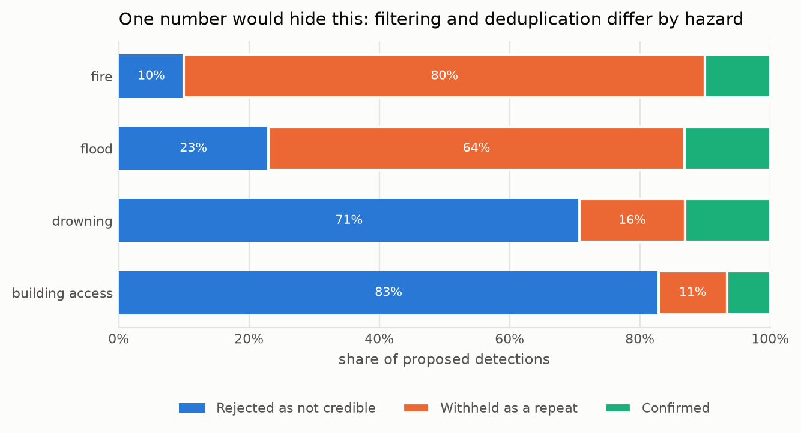

# VIGÍA

**Disaster detection for the cameras cities already have.**
Published detectors for fire, flood, people in water and people trapped in
damaged buildings, behind one shared validator that decides which alarms are
worth a human's attention.

[](https://github.com/jandoni/vigia/actions/workflows/checks.yml)
[](LICENSE)
[](pyproject.toml)
[](docs/paper/vigia.pdf)

[Paper](docs/paper/vigia.pdf) · [Results](RESULTS.md) · [Contributing](CONTRIBUTING.md) · [Cite](CITATION.cff)

> [!IMPORTANT]
> **Looking for maintainers.** I built VIGÍA between 2025 and 2026 and I no
> longer have the time it deserves. The code runs, CI is green and every
> published number is reproducible. [CONTRIBUTING.md](CONTRIBUTING.md) is a
> full handover: how the project thinks, how to run it, and the open problems
> in the order I would tackle them. If you want to pick it up, open an issue.



*Left: every detection the raw detector proposes, which is what most demos
show. Right: what survives validation and actually reaches a person. On this
clip, 451 proposals became 59 alerts. Rendered by `scripts/record_demo.py
--split`. Footage: SeaDronesSee (CC0), University of Tübingen.*

---

## Why it exists

On 29 October 2024 a DANA (a cut-off low storm) flooded Valencia and killed
223 people. Spanish cities already run tens of thousands of cameras. That
evening many of them were pointed at streets and riverbeds while the water
rose, and nobody was watching them.

Detecting a hazard in a frame is mostly a solved problem: public datasets and
published models exist for fire, flood and people in water. What keeps them
out of control rooms is that they cry wolf. Measured on PyroNear's own
validation split, their published wildfire detector raises an alarm on **71%
of frames with no smoke in them**. That is the operating point its authors
chose, on the assumption that something downstream filters the output.

VIGÍA is that downstream step. It reads each camera's context, runs only the
specialists that make sense there, and holds every detection until it has
persisted long enough to be believed. The contribution is the validator and
the evaluation that measures what it buys and what it costs. Everything else
is integration, and every detector is credited by name.

**Recognition.** First prize in the second *Jóvenes Ingenieros por un Mundo
Mejor* (Young Engineers for a Better World) competition, Instituto de la
Ingeniería de España, November 2025
([Ineco announcement](https://www.ineco.com/ineco/en/communication/news/ineco-awards-prize-second-young-engineers-better-world-competition-innovative-vigia-system)).

---

## What it looks like

`make dev` starts a demonstration at http://127.0.0.1:8000 with recorded clips
and four live public cameras (two USGS river gauges, two HPWREN wildfire
lookouts), all running through the same pipeline.



<table>
  <tr>
    <td width="50%"></td>
    <td width="50%"></td>
  </tr>
  <tr>
    <td><sub><b>Live camera.</b> Confirmed swimmers in yellow. Grey boxes were proposed and rejected, labelled with the level that stopped them.</sub></td>
    <td><sub><b>Analyse a video.</b> A scene router reads the footage and picks the specialist. 20 flags, 2 findings worth a look.</sub></td>
  </tr>
  <tr>
    <td width="50%"></td>
    <td width="50%"></td>
  </tr>
  <tr>
    <td><sub><b>Engineer's view</b> (<code>/operator</code>). Per-level counts on a UAV clip over collapsed buildings: 2,759 proposals, 27 persistent, 7 confirmed.</sub></td>
    <td><sub><b>How it works.</b> The same pipeline explained for a municipal audience.</sub></td>
  </tr>
</table>

Turn off "show everything the camera proposed" and it becomes an ordinary
detection demo. The gap between the two views is the point of the project.

---

## How it works



**Tier 0 is declared, not learned.** Each camera is registered once with a
context (forest, river, street, coast, UAV search) and a viewpoint (ground,
oblique, nadir aerial). The gate looks up which hazards apply. On the example
registry that is 9 detector invocations per frame instead of 25, and models no
camera needs are never loaded. A pairing outside a model's viewpoint envelope
is refused at start-up: the ground-level flood model once reported 0.397 water
coverage on aerial frames of mown grass, and a confident wrong number is worse
than an error.

**Tier 1 is borrowed.** Each hazard has its own detector, built by people who
know that problem: PyroNear for wildfire, SeaDronesSee for people in water,
DRespNeT for building access. Two flood segmenters were trained here (ATLANTIS
for ground cameras, FloodNet for aerial). All of them run through ONNX Runtime.

**Tier 2 is the contribution.** Three levels, cheapest first, each switchable
so the ablation table comes from the same code that runs in production. It is
hazard-agnostic: configured per hazard, never specialised, and a test parses
`cascade.py` and fails the build if a hazard name appears in a comparison. Two
more levels (size plausibility and a colour prior) were built, measured and
removed because they cost more recall than they saved.

---

## Measured results

Every figure below traces to a file in `eval/results/`, checked by
`tools/freeze_results.py`, which fails the build if the summary and the
measurement disagree. Full table in [RESULTS.md](RESULTS.md).

| hazard | headline | measured on |
|---|---|---|
| Fire | false-alarm rate **0.706** for the raw detector (the number the validator must beat) | 585 negatives, 21 cameras |
| Flood | water IoU **0.7633** | held-out ATLANTIS test, 1,296 images |
| People in water | swimmer box F1 **0.9172** | SeaDronesSee val, 300 images |
| Building access | civilian box recall **0.942** | held-out DRespNeT test, 24 images |

**Suppression is reported as two numbers, not one.** Across the demonstration
clips, 1,255 proposals became 117 confirmed events. As a single figure that is
91% suppression, but 74.4% was *rejected as not credible* and 16.3% was
*withheld as a repeat of an event already reported*. Only the first supports a
false-alarm claim, and the split changes completely between hazards:



On the fire clip, quoting the combined figure would claim 90% where the
honest number is 10%.

**The validator has a cost, and it is reported.** On FIgLib wildfire
sequences it cuts the false-alarm rate from 0.040 to 0.010 and finds the same
6 of 6 fires as the raw detector, but the first alert arrives about two
minutes later. An oracle-tuned confidence threshold of 0.26 reaches the same
false-alarm rate at higher recall. The validator's case is that it gets there
without seeing the negative distribution first, and that it deduplicates,
which no threshold can do. Section 6.6 of the paper covers this control.

---

## What this project does not claim

- **Temporal confirmation for fire is not new.** PyroNear already run
  sequential evaluation. The claim is narrower: a hazard-agnostic validator,
  measured across four hazards, with a published per-level ablation.
- **The flood trend signal is not new either.** Choi et al. published
  Page-Hinkley change detection for this problem. Both that and a
  sliding-window fit are implemented and compared on identical inputs.
- **Road incidents are a generality experiment, not a disaster hazard.** The
  detector is integrated but has no standalone held-out measurement.
- **Building access rests on 24 held-out images.** Image-level recall is
  1.000 with a 95% interval of [0.757, 1.000]. The sample cannot be widened
  from released data.
- **There is no urban flood footage yet.** The demo uses a creek gauge
  camera. Licensed footage of a flooded street is the biggest gap in the
  story (see [CONTRIBUTING.md](CONTRIBUTING.md#open-problems)).

---

## Try it

Requires Python 3.11+. The runtime is ONNX Runtime only: no PyTorch, no
Ultralytics.

```bash
python -m venv .venv && .venv/bin/pip install -e '.[web]'
.venv/bin/python tools/fetch_models.py      # weights are fetched, never committed
make dev
```

`make dev` builds any missing clips, loads only the models the gate needs,
starts every demonstration camera and opens http://127.0.0.1:8000. The
interface has five screens, each with its own URL (`/overview`, `/analyse`,
`/live`, `/how-it-works`, `/teach`), plus the engineer's view at `/operator`.

```bash
make dev-loop     # recorded clips replay continuously (runs the laptop hot)
make dev-offline  # clips only, no public live cameras
make check        # the three guards plus the test suite
make clips        # rebuild the demonstration clips from local data
make paper        # rebuild the technical paper (LaTeX -> docs/paper/vigia.pdf)

# the gate's routing decisions, loading no models at all
.venv/bin/python scripts/run_pipeline.py --explain
```

Model weights, datasets and clips are not in this repository. Weights come
from their original distributors through `tools/fetch_models.py`; datasets
through the fetchers in `eval/` (see
[docs/DATA_ACQUISITION.md](docs/DATA_ACQUISITION.md)).

---

## Repository

```
vigia/              runtime: ONNX only, no torch, no ultralytics
  registry.py         Tier 0: cameras, contexts, viewpoints, retention
  detectors/          one per hazard, on a shared ONNX base
  validator/          Tier 2: the cascade and the IoU tracker
  flood/level.py      water level, least-squares trend, Page-Hinkley
  pipeline.py         capture -> gate -> detect -> validate -> emit
  io/                 sources, live public cameras, the single alert egress
  web/                FastAPI server, demo UI and operator view (no build step)
eval/               harnesses and results; every published number lives here
scripts/            training, ONNX export, clips, demo recording
tools/              guards: licence, privacy, results freeze; model fetcher
tests/              registry, flood level, validator, web contract
docs/paper/         the technical paper, LaTeX, one file per section
docs/figures/       charts generated from eval/results
models/REGISTRY.yaml  runtime config and attribution in one file
```

## Guards

All three run in CI and fail the build:

```bash
.venv/bin/python tools/check_licence.py    # no AGPL package in the runtime path
.venv/bin/python tools/check_privacy.py    # no biometric identification, anywhere
.venv/bin/python tools/freeze_results.py   # every published figure matches its source
```

`check_privacy.py` parses the tree and fails on any face, gait or
re-identification code path, in `tools/`, `scripts/` and `eval/` as well as
the runtime. Person boxes are blurred before an evidence frame is written,
and the alert type has no video field. VIGÍA needs to identify nobody, and
being architecturally unable to is more credible than promising not to.

---

## Contributing

Read [CONTRIBUTING.md](CONTRIBUTING.md) first. It explains the rules the
project runs on (measured numbers only, generated figures, licence and privacy
perimeters), how to add a detector or a camera, and the open problems in
priority order. The short version of what would help most:

1. Licensed footage of an urban flood, ideally the 2024 Valencia DANA.
2. A larger post-disaster aerial dataset to widen building access beyond 24
   test images.
3. A standalone measurement of the road-incident detector.

## Licence and credits

Apache-2.0. Model weights and datasets carry their own licences, recorded per
model in `models/REGISTRY.yaml` and credited in [NOTICE](NOTICE). No weights
and no third-party imagery are redistributed here. Demonstration footage:
SeaDronesSee (CC0, University of Tübingen), HPWREN (University of California
San Diego, attribution required), USGS (public domain), DRespNeT (CC BY 4.0).

## Paper and citation

The technical paper lives in `docs/paper/` and is rebuilt by `make paper`;
`make arxiv` packages it for arXiv. Every number in it is generated from
`eval/results/`, every proportion carries a confidence interval, and it
includes the control experiment that partly deflates the headline. Cite it
through [CITATION.cff](CITATION.cff).
